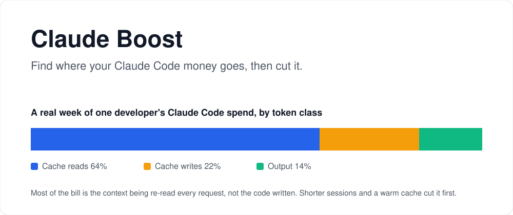

# Claude Boost: Claude Code cost optimizer

**Long Claude Code sessions cost 65% less, with the same quality. Free, local, and it adds zero tokens to your requests.**

[](LICENSE) [](tools/boost.py) [](#install) [](#privacy) [](#whats-in-it) [](https://github.com/JacobTheJacobs/claude-boost-cost-optimizer)

<picture>
  <source media="(prefers-color-scheme: dark)" srcset="docs/hero-dark.svg">
  
</picture>

## Result

| 10 tasks in one session, Opus 5.5 | Tasks passed | Cost per session |
|---|:-:|--:|
| Plain Claude Code | 20/20 | $4.97 |
| **With Claude Boost** | **20/20** | **$1.74 (-65%)** |

40 graded tasks, 2026-11-12. Reproduce: `python3 evals/long.py --reps 2`.

## Why it works

Every request re-sends the whole session. By task 10 of a long session, each request re-reads ~175K tokens of old history, and that re-reading is most of the bill, not the code written. Starting fresh per task keeps each request near Claude Code's ~16K-token baseline.

So Boost watches the session size and tells you when a fresh start pays off. On short sessions it stays silent and costs nothing.

## Install

```bash
git clone https://github.com/JacobTheJacobs/claude-boost-cost-optimizer.git claude-boost
cd claude-boost && ./install.sh
```

Then add the hook it prints to `~/.claude/settings.json`:

```json
"hooks": {
  "UserPromptSubmit": [{ "hooks": [{ "type": "command", "command": "python3 /path/to/claude-boost/hooks/session_guard.py" }] }]
}
```

## What's in it

| Part | What it does | Tokens added per request |
|---|---|---|
| `hooks/session_guard.py` | Past 100K tokens of context (`BOOST_CLEAR_AT`), shows you: "new task? `/clear` first". Silent below that. | 0 |
| `tools/boost.py` | Shows where your money went: cache reads vs writes vs output, per model, project, session. | 0 |
| `skills/lean/` | Smallest-change checklist and short answers, loaded only when called. | 0 until called |
| `agents/reader.md` (`./install.sh --reader`) | Haiku 5.5 helper for bulky reads (many files, big logs). | ~550 |
| `hooks/cache_guard.py` (optional) | Warns before a mid-session CLAUDE.md or settings edit, which re-writes the whole cache. | 0 |
| `hooks/budget.py` (optional) | Daily dollar cap via `BOOST_DAY_USD`. Off unless set. | 0 |

## Habits that save the most

1. **`/clear` between unrelated tasks.** The measured 65%.
2. **`/compact` early** when you stay on one task. Long contexts are re-read on every request.
3. **Don't edit CLAUDE.md, settings, model or effort mid-session.** Each change re-writes the whole cached prompt; Anthropic measured 20-50x the cost of the same text sent as a message.
4. **Ask for short answers.** Output costs 5x input.
5. **Run `python3 tools/boost.py --days 7` weekly.** If cache reads dominate, your sessions are too long.

Sources: Anthropic's [cost guide](https://platform.claude.com/docs/en/about-claude/models/optimizing-for-cost-and-intelligence) and [cookbook](https://platform.claude.com/cookbook/cost-optimization-cost-optimization).

## FAQ

**Why is my Claude Code bill high when I write little code?** Each request re-reads the whole context. A 300K-token session re-read 50 times is 15M tokens.

**Does it help short tasks?** No, and it doesn't cost them anything either. A short task has no long context to cut.

**Can I use Haiku for subagents?** Yes, with a named agent file (`model: haiku`) like `agents/reader.md`. `fork` subagents always use your main model.

## Privacy

Everything runs on your machine. No network calls, no telemetry. `boost.py` reads `~/.claude/projects`; the hooks read stdin and print one line.

## License

MIT.
